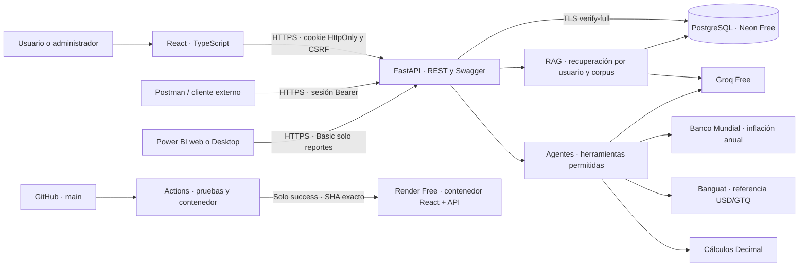
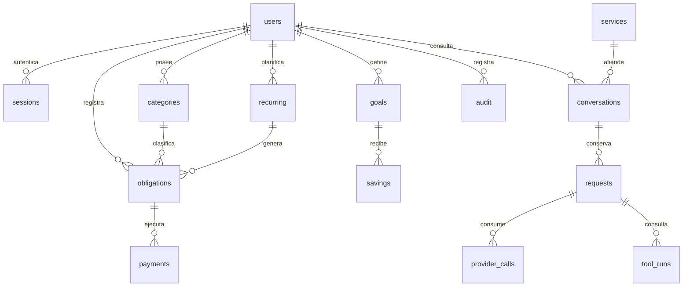

# Arquitectura de Saldo

El bloque React/API se sirve desde un solo origen. No hay disco persistente en
Render: movimientos, corpus, sesiones, herramientas, conversaciones y consumo
se conservan en PostgreSQL. El frontend no recibe claves Groq o de la BD.

## Modelo relacional

`knowledge` alimenta RAG. `budgets` registra reservas de organización por día y
minuto; `users` conserva cuota acumulada por usuario. Las reservas en curso
quedan en `requests`: tras una interrupción se concilian conservadoramente,
sin borrar consumos desconocidos. Un proceso de recuperación al arrancar cierra
llamadas pendientes de más de 15 minutos y solicitudes sin llamada de más de 30.

## Reporterías

Web y Power BI consumen `/api/v1/reports/summary` y `/usage`, con las mismas
reglas de fecha Guatemala, servicio y permisos. Solo incluyen solicitudes
terminadas antes de `as_of`. `/usage` pagina por `(created_at,id)`; las llamadas
se agregan por solicitud para no inflar el número de peticiones del usuario.

## Entorno

Local y CI: PostgreSQL 17. Neon creado en PostgreSQL 18. Ambas versiones soportan
el SQL usado; la migración cloud se verifica por separado. Docker Compose limita
la aplicación a 512 MB y publica únicamente 127.0.0.1:8000. Subdominio HTTPS de
Render para la publicación. Fabric no interviene en el backend.
