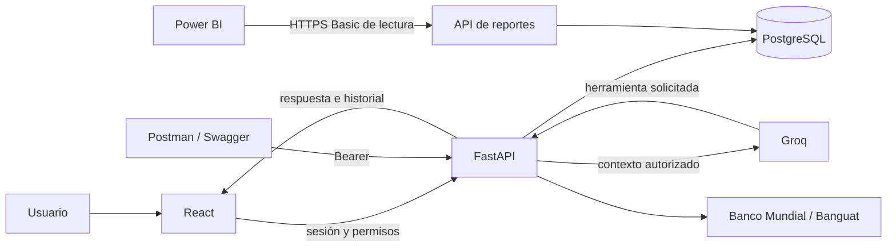

# Cómo funciona Saldo, de principio a fin

Saldo permite registrar ingresos, gastos, pagos y metas de ahorro, y conversar
sobre esos registros. El usuario conserva el control: una respuesta del asistente
no crea pagos, no mueve dinero y no contrata productos. La moneda operativa es
el quetzal. El alcance de entrega es el [enunciado original](alcance.md), no toda
la visión futura del documento de propuesta inicial.

Este documento explica la implementación. Las comprobaciones, fechas y límites
observados de la entrega se publican por separado en [estado](estado.md). Una
función descrita aquí no demuestra, por sí sola, que la versión cloud ya se haya
actualizado.

## La explicación en un minuto

Registras tus finanzas en la web y la API las valida y guarda en PostgreSQL.
Cuando preguntas, el servidor consulta tus datos y las guías pertinentes; si
hace falta interpretar o planificar, Groq recibe ese contexto acotado y puede
pedir herramientas de lectura. Los cálculos los hace el servidor. La respuesta,
sus fuentes y su consumo quedan en el historial. Power BI importa las
solicitudes de la API publicada para mostrar el mismo reporte de uso. GitHub
conserva el código y solo publica en Render después de aprobar las pruebas.

Local y nube son copias separadas. La nube usa Render para ejecutar, Neon para
guardar, Groq para inferir y Microsoft para el informe. Ubuntu administra todo
por Docker, terminal y navegador. Ninguno de esos servicios recibe por defecto
acceso a los demás: la API conecta los componentes con credenciales privadas.

## 1. Qué ve cada persona

- **Usuario:** sus finanzas, metas, recurrentes, tres asistentes, su historial y
  su consumo. No puede consultar las finanzas de otra cuenta.
- **Administrador:** además administra usuarios, fuentes educativas y servicios
  de IA, asigna cuotas y consulta el historial/consumo de las cuentas autorizadas.
- **Cuenta BI:** tiene acceso de lectura a los reportes, con un alcance fijado en
  el servidor. No puede usar la IA ni registrar o modificar finanzas.

Al crear una cuenta desde el acceso, el servidor le asigna rol de usuario y una
cuota inicial. No se pueden obtener permisos administrativos añadiendo campos a
la petición. Al cerrar sesión se revoca la sesión; al cambiar de cuenta, la
interfaz descarta los datos y las pantallas de la identidad anterior.

## 2. Dónde vive cada parte

| Parte | Tecnología | Trabajo que realiza |
|---|---|---|
| Pantallas | React, TypeScript y Vite | Presentan formularios, tarjetas, chat, historial y reportes. Se ejecutan en el navegador. |
| Servidor y API | Python 3.12, FastAPI, Pydantic y Uvicorn | Valida entradas, aplica permisos, realiza cálculos, coordina la IA y expone los mismos servicios a la web y a clientes externos. |
| Base de datos | PostgreSQL | Conserva cuentas, finanzas, documentos recuperables, sesiones, conversaciones, herramientas y consumos. |
| Ejecución local | Docker Compose; PostgreSQL 17 | Permite levantar una copia completa en Ubuntu sin instalar manualmente todos los componentes. |
| Publicación | Render Free | Ejecuta un contenedor que entrega las pantallas y la API por HTTPS desde el mismo origen. |
| Base publicada | Neon Free; PostgreSQL 18 | Conserva los datos de la versión pública, con conexiones cifradas. |
| Modelo de lenguaje | Groq Free; `openai/gpt-oss-120b` en la configuración revisada | Interpreta preguntas abiertas, decide herramientas y redacta respuestas. No recibe la contraseña de la base de datos. |
| Datos externos | Banco Mundial y Banco de Guatemala | Aportan inflación anual publicada y referencia USD/GTQ, respectivamente. |
| Reportería | Power BI web, Power Query y archivo PBIX | Importa desde la API las solicitudes y el consumo para filtrarlos y contrastarlos con la web. |
| Código y publicación controlada | GitHub y GitHub Actions | Conservan la versión del código, ejecutan pruebas y solicitan el despliegue solo si estas aprueban. |

Las versiones de dependencias están fijadas en `requirements.lock` y
`frontend/package-lock.json`. El modelo es una configuración del servicio: no
se descarga ni se entrena dentro de Render. Cambiarlo exige volver a comprobar
calidad, compatibilidad con herramientas y límites gratuitos. Para GPT-OSS se
utiliza razonamiento medio, temperatura 0,2 y razonamiento oculto en la respuesta;
ocultarlo no elimina su consumo. La salida máxima se configura por servicio.

## 3. Recorrido de un registro financiero

Imagina que Ana crea una obligación de Universidad por Q900 y registra un abono
de Q400:

1. Completa el formulario en React. El navegador envía una petición a la API.
2. La API identifica la sesión, comprueba que la categoría pertenece a Ana y
   valida monto, fecha y estado. No confía en un ID de usuario escrito en el
   formulario para decidir la propiedad.
3. PostgreSQL guarda la obligación y, por separado, cada pago. El pendiente no
   es un número introducido manualmente: se deriva de lo previsto menos lo
   pagado.
4. El tablero vuelve a consultar la API y muestra Q900 planificados, Q400
   ejecutados y Q500 pendientes. Un abono excesivo se rechaza sin alterar el
   pago anterior.
5. Las consultas del asistente leen esos mismos registros; no mantienen una
   copia independiente de los saldos.

La fecha del **pago** determina en qué período aparece la ejecución. La fecha
límite de la obligación determina su vencimiento. Un pendiente anterior se
muestra como arrastre: no se crea otra deuda cada mes.

Las plantillas recurrentes generan una instancia por mes al solicitar el
tablero. La unicidad en la base evita duplicados. Cambiar una plantilla no
reescribe las obligaciones ya generadas ni sus pagos; afecta los meses que
todavía corresponda generar. No se necesita un programador de tareas pagado.

En ahorro, cada aporte o retiro es otro movimiento. El saldo de una meta es la
suma de sus movimientos. Un aporte aumenta el ahorro y reduce el disponible,
pero no se suma a los gastos de consumo. Eliminar una meta elimina también
sus movimientos en una transacción, después de una confirmación explícita;
esto cambia los totales históricos de ahorro. La auditoría de la acción se
conserva.

Todos los cálculos monetarios se realizan con `Decimal` y columnas `NUMERIC`,
con dos decimales para importes. Se evita la aritmética aproximada de números
binarios. El flujo disponible se calcula así:

**Ingresos cobrados - pagos realizados - aportes netos a ahorro.**

Ese flujo registrado no equivale al saldo bancario ni demuestra, por sí solo,
que todo el importe pueda destinarse a una nueva deuda o meta.

## 4. Recorrido de una pregunta

1. El usuario elige un asistente y envía una pregunta junto con el identificador
   de su conversación, cuando ya existe.
2. La API comprueba identidad, servicio disponible, pertenencia de la
   conversación y que no haya otra pregunta ejecutándose en ese mismo chat.
3. Se registra la solicitud. Así también pueden conservarse los fallos y sus
   consumos; no se borra una pregunta porque no haya terminado bien.
4. El servidor reconstruye una memoria acotada y determina si puede resolver
   una consulta sencilla con cálculos y una respuesta verificada. Por ejemplo,
   una comparación clara entre dos categorías no necesita inferencia.
5. Si necesita el modelo, reúne únicamente contexto autorizado: documentos
   pertinentes, período de conversación y resultados calculados. Antes de cada
   llamada reserva cuota personal y compartida.
6. Groq puede responder o solicitar una herramienta permitida. El servidor
   valida sus argumentos, ejecuta la consulta o cálculo y le devuelve el
   resultado. La herramienta no ejecuta SQL libre escrito por el modelo.
7. Si hacen falta más pasos, se repite ese ciclo hasta el máximo configurado.
   Cada llamada cuenta; una pregunta puede producir varias llamadas.
8. Se guarda la respuesta, el estado, las fuentes, las herramientas y el
   consumo. React recibe una respuesta natural. Historial permite revisar el
   detalle que no se muestra dentro del texto del chat.

Los asistentes no modifican registros financieros. Si sugieren ahorrar Q200,
es una recomendación o escenario; el usuario decide si registra un aporte.

## 5. Qué significa RAG en este proyecto

RAG significa **buscar información antes de responder**. No es entrenar un
modelo con toda nuestra base. En Saldo se combina:

- Un corpus educativo en la tabla `knowledge`.
- Registros financieros autorizados del usuario que formula la pregunta.
- Herramientas que consultan y calculan datos actuales cuando una búsqueda de
  texto no basta.

La búsqueda de documentos y movimientos usa búsqueda de texto completo en
español de PostgreSQL: convierte palabras en términos buscables, busca
coincidencias y ordena por relevancia. Recupera una cantidad limitada de
fragmentos y registros. **No utiliza embeddings, base vectorial, entrenamiento
propio ni un servicio de búsqueda de pago.** Las preguntas que requieren sumar
muchos movimientos se atienden con consultas agregadas, no enviando todas las
filas al modelo.

### Instrucciones frente a documentación recuperada

`backend/agent_docs/00_instrucciones.md` contiene reglas de comportamiento que
carga el servidor. Las demás guías explican gastos, deudas, ahorro, contexto y
consultas disponibles. `python -m backend.knowledge` divide esas guías en
fragmentos e importa o actualiza su contenido en PostgreSQL. Puede repetirse
sin duplicar indefinidamente las fuentes gestionadas; conserva las fuentes
administradas de forma independiente.

La configuración administrativa usa los espacios `rag`, `budget` y `goals`.
Se puede crear o recrear la configuración de un espacio disponible, editarla,
consultarla y darla de baja lógica. La baja conserva historial y consumo; para
restaurarla se usa el alta. No se implementa un agente nuevo escribiendo un ID
arbitrario. El modelo, salida y rondas forman parte de esa configuración.

Editar un documento de la tabla `knowledge` no cambia los permisos del agente.
El servidor trata documentos, títulos y resultados como datos, no como órdenes.
La documentación orienta la interpretación; la lista de herramientas y las
validaciones del backend determinan lo que realmente se puede hacer.

Una fuente educativa sobre la bola de nieve puede explicar el método; los
saldos que se usan para aplicarlo proceden de las deudas registradas de esa
persona. Una guía no autoriza inventar intereses, cuotas mínimas ni fechas de
liquidación que no se registran en el sistema.

## 6. Los tres servicios

| Servicio visible | Identificador API | Cómo trabaja |
|---|---|---|
| Consulta tus finanzas | `rag` | Recupera documentación y registros propios; consulta rankings, pagos, pendientes, deudas, recurrentes y metas con herramientas de lectura. |
| Analiza tu presupuesto | `budget` | Combina flujo y gastos propios con consultas y escenarios. Cuando la pregunta lo requiere puede consultar la inflación anual de Guatemala en Banco Mundial. |
| Explora tus metas | `goals` | Consulta metas y capacidad registrada; calcula escenarios de aportes y plazos. Puede consultar la referencia USD/GTQ de Banguat cuando se necesita ese dato. |

Los tres comparten controles de seguridad y acceso a hechos financieros. Su
especialización cambia las herramientas externas y el recorrido de la
solicitud; no significa que cada servicio tenga una base de datos distinta.

Un **agente** es ese ciclo de decidir qué falta, solicitar una herramienta,
leer su resultado y continuar. No es un proceso autónomo que opere la cuenta
sin petición del usuario. Las listas permitidas, argumentos, tiempos y rondas
lo mantienen acotado.

No todas las preguntas necesitan datos externos. Consultar Banguat para
comparar dos gastos GTQ introduciría trabajo innecesario. Para demostrar los
dos agentes con fuentes externas se utilizan preguntas expresas de inflación
y referencia cambiaria, además de los cálculos internos.

### Ejemplo de presupuesto

El usuario pide comparar octubre con inflación anual 2025. La herramienta
interna obtiene ingresos, pagos y ahorro de octubre; `inflation` consulta el
indicador `FP.CPI.TOTL.ZG` para Guatemala. El modelo explica los resultados y
advierte que un indicador anual 2025 no es inflación mensual de octubre 2026.
Si no hay dato publicado, devuelve esa ausencia: no estima uno para completar
la respuesta.

### Ejemplo de metas

El usuario elige el Fondo de emergencia y pide comparar seis aportes de Q500
con seis de Q750. Se consulta el saldo actual de esa meta y se calculan ambas
proyecciones con el backend. El modelo explica la diferencia y sus supuestos.
La referencia Banguat se consulta si la petición incluye una comparación
USD/GTQ. Una proyección no descuenta ni abona dinero en la base.

## 7. Cómo recuerda la conversación

Cada asistente mantiene su propia conversación. La base conserva solicitudes
persistentes, pero la memoria enviada al modelo está acotada: hasta seis
intercambios completos y un límite de caracteres. El sistema también conserva
referencias estructuradas verificadas, como período consultado y metas o
categorías mencionadas por herramientas.

Por eso «¿cuánto de diferencia en ese mismo mes?» puede seguir una comparación
anterior. Un mes explícito en la pregunta nueva tiene prioridad. Una fecha
ambigua requiere aclaración en lugar de asumir un período sin fundamento.
Los importes anteriores no se convierten en un saldo vigente: un cálculo
nuevo vuelve a consultar los datos que corresponden.

Nueva conversación reinicia el hilo activo; una recarga comienza una vista de
chat nueva. El historial guardado sigue disponible. Ninguna de esas acciones
renueva tokens ni elimina consumo.

## 8. Calidad y consumo

El texto del chat se redacta en español natural, con respuestas breves. La
presentación evita tablas sin renderizar, códigos internos y traducciones de
campos. Las fuentes y pasos técnicos permanecen consultables en Historial.
Hay controles para detectar importes explícitos sin respaldo y para conservar
la diferencia entre previsto, ejecutado, pendiente y simulado. Estos controles
no certifican toda la interpretación de cualquier pregunta posible.

Hay cuatro límites diferentes:

| Límite | Qué significa |
|---|---|
| Cuota personal | Permiso acumulado asignado al usuario. No son créditos comprados ni se renueva automáticamente cada día. |
| Presupuesto compartido local | Tope de la aplicación para todos los usuarios: día UTC, minuto y número de llamadas por minuto. |
| Capacidad de una llamada | El contexto y la salida deben caber en un presupuesto acotado; se reservan antes de llamar. |
| Cuota de Groq | Restricción real del proveedor para la organización y modelo; no aumenta al editar una cuota local. |

La configuración revisada utiliza hasta 100.000 tokens acumulados por usuario,
100.000 compartidos por día UTC, 7.000 por minuto y 24 llamadas por minuto. La
preparación de una llamada tiene un techo de 6.500 tokens de reserva. El máximo
de salida configurable es 768 tokens y el máximo de rondas es seis; cada
servicio puede usar un límite menor. Confirmar los valores actuales en código,
Administración y cuenta del proveedor antes de una presentación.

Un día UTC termina a las **18:00 de Guatemala**. Reiniciar el contenedor,
recargar o abrir otra conversación no renueva esos presupuestos. El proveedor
puede tener su propia forma de medir y renovar límites.

Se cuenta entrada y salida de todas las rondas, no solo las palabras visibles.
La información enviada al modelo y su razonamiento pueden consumir tokens
aunque la respuesta final sea corta. Una consulta SQL sin modelo no consume
Groq, aunque leer muchos resultados y enviarlos completos sí aumentaría la
entrada del modelo.

El contexto se compacta de forma controlada: se retiran intercambios antiguos
completos y detalles opcionales, conservando pregunta, fechas, reglas,
resultados válidos y totales. En ciertos casos se puede ofrecer un resumen
calculado, identificado como tal, cuando no cabe otra ronda. No se presenta
como inferencia exitosa una llamada que falló.

`local_only: true` permite pedir una respuesta calculada sin contactar al
proveedor durante una espera, con cuota personal agotada o sin clave. Si la
pregunta no tiene un recorrido local suficiente, devuelve una explicación
sin llamar a Groq. La inferencia sigue necesitando clave y reserva disponible;
este modo no renueva límites ni permite otros datos o servicios.

Si una conexión se interrumpe sin confirmar el consumo, la aplicación conserva
una estimación prudente. La recuperación al arrancar concilia reservas antiguas
de forma idempotente. No se regalan tokens desconocidos ni se borran solicitudes
para mejorar el reporte.

## 9. Historial y reporte de uso

La trazabilidad tiene tres niveles:

- **Solicitud:** una pregunta del usuario, con estado y respuesta o error.
- **Llamada al proveedor:** cada ronda de modelo, con entrada y salida.
- **Herramienta:** cada consulta o cálculo y sus argumentos/resultados.

Una pregunta con cuatro pasos puede tener varias herramientas y llamadas.
Contar preguntas no equivale a contar llamadas. Una respuesta calculada puede
ser una solicitud exitosa con cero llamadas y cero tokens.

El reporte agrupa por servicio y permite filtrar por fecha y usuario según
permisos. La fecha de reporte usa America/Guatemala; las marcas técnicas se
guardan en UTC. Las tarjetas de cuota muestran acumulado personal; la tabla
muestra el intervalo seleccionado. No son la misma medida.

## 10. Recorrido hasta Power BI

1. La API publicada lee solicitudes y suma sus llamadas desde Neon.
2. Power Query consulta `/api/v1/reports/usage` por HTTPS usando la cuenta BI.
   La contraseña se configura en Microsoft, no dentro de la consulta M.
3. Recorre todas las páginas utilizando un mismo corte `as_of`. Ese corte evita
   mezclar filas nuevas a mitad de una actualización.
4. Power BI importa los datos en su modelo. Los gráficos y filtros trabajan
   sobre esa copia importada.
5. Una actualización del modelo vuelve a consultar la API. Refrescar solo la
   página del informe no equivale a importar datos nuevos.
6. Para comparar, la web y la API deben usar usuario, período y servicio iguales.
   Debe mantenerse el mismo conjunto de solicitudes terminadas durante el
   contraste o usar el mismo `as_of`.
7. El PBIX descargado contiene informe y modelo a esa fecha. **No se actualiza
   solo un archivo ya descargado ni el PDF de evidencias.** Para entregar un
   corte nuevo hay que actualizar, comprobar y descargar otra vez.

Power BI consulta Render/Neon, **no la base local de localhost**. Si Ana hace
una prueba local, esa solicitud no aparecerá en el informe conectado a la API
pública. El código puede ser el mismo, pero son instalaciones y datos distintos.

La configuración no necesita gateway local porque la API es HTTPS pública.
Fabric/Power BI se usan para el informe; no sostienen el funcionamiento del
backend. Una prueba de Fabric próxima a vencer no bloquea el registro de
finanzas, pero sí puede afectar permisos de creación, actualización o descarga
en Microsoft. Revisar la licencia y conservar el PBIX con antelación.

## 11. Publicación, pruebas y reproducibilidad

El Dockerfile compila React con Node y construye un contenedor Python. Al
iniciar, aplica migraciones, recupera reservas antiguas y levanta FastAPI. En
Render se sirve el frontend compilado desde la misma aplicación, lo que
simplifica sesiones y evita otra publicación del frontend.

GitHub Actions ejecuta pruebas backend sobre PostgreSQL aislado y otro trabajo
construye y arranca el contenedor. El despliegue necesita el éxito de ambos y
un cambio en `main`. Usa un hook privado de Render para solicitar el SHA exacto
y comprueba `/api/health` hasta que la versión publicada y la base sean las
esperadas. El auto-deploy directo de Render debe permanecer apagado para no
saltarse esas pruebas.

Las pruebas automatizadas simulan Groq y fuentes externas: no gastan tokens.
Las pruebas reales se realizan aparte, con pocos casos y presupuesto explícito.
Un CI aprobado verifica los casos cubiertos; no garantiza que toda red externa
estará disponible durante cualquier presentación.

## 12. Configuración y secretos

La aplicación local usa `.env`; producción tiene variables privadas propias.
`DATABASE_URL` conecta con la base, `GROQ_API_KEY` habilita el proveedor y las
contraseñas iniciales sirven para el seed. `COOKIE_SECURE` debe estar activo en
HTTPS. Las conexiones Neon requieren TLS y validación del certificado.

No deben publicarse `.env`, `.env.cloud`, claves SSH, tokens de sesión, hooks de
despliegue, contraseñas BI ni respaldos que contengan hashes/sesiones. El
repositorio contiene ejemplos vacíos y código de creación, no las credenciales
operativas. Cambiar una clave exige actualizar su destino privado; un commit no
actualiza las variables de una plataforma automáticamente.

## 13. Cómo reproducir y restaurar

El [README](../README.md) explica el arranque y [portabilidad](portabilidad.md)
distingue la copia local del acceso cloud. En una copia nueva se crean
contraseñas propias, se levantan los contenedores, se aplican migraciones y se
carga el seed. `backend.demo` amplía el escenario local de forma explícita;
`backend.knowledge` importa las guías. Esas operaciones son diferentes de subir
código a GitHub.

Los datos locales están en un volumen Docker; no viajan en el repositorio. Un
respaldo se realiza con `pg_dump`, se guarda en privado y se restaura primero en
una base nueva. Hay que usar herramientas y versión destino compatibles; no
se asume que un dump de PostgreSQL 18 pueda restaurarse en 17. No eliminar el
volumen para probar recuperación sobre la única copia existente.

Ubuntu permite desarrollo, Docker, administración cloud, Power BI web y
exportación de los archivos que se comprobaron. Si se decide abrir el PBIX en
Power BI Desktop, basta un Windows compatible ya disponible, el archivo y la
credencial BI. No se migra Render, Neon ni Groq a Windows.

## 14. Recorrido de demostración y límites del producto

El [guion de demostración](guion-demostracion.md) propone una exposición corta;
la [aceptación final](aceptacion-final.md) es más extensa y comprueba errores,
permisos y entregables. Para explicar el sistema basta seguir:

**Login → registrar/consultar finanzas → preguntar → revisar herramientas y
consumo → consumir la misma API externamente → actualizar Power BI → mostrar
PBIX, PDF y repositorio.**

La aplicación organiza los datos que el usuario registra. No conoce cuentas
bancarias, tasas contractuales, gastos omitidos ni ingresos no introducidos.
No ejecuta pagos ni ofrece una amortización bancaria completa. Las estrategias
educativas de ahorro y deuda deben reconocer esas ausencias. Costo cero significa
operar dentro de las cuotas disponibles, no capacidad ilimitada o disponibilidad
permanente de los proveedores.
